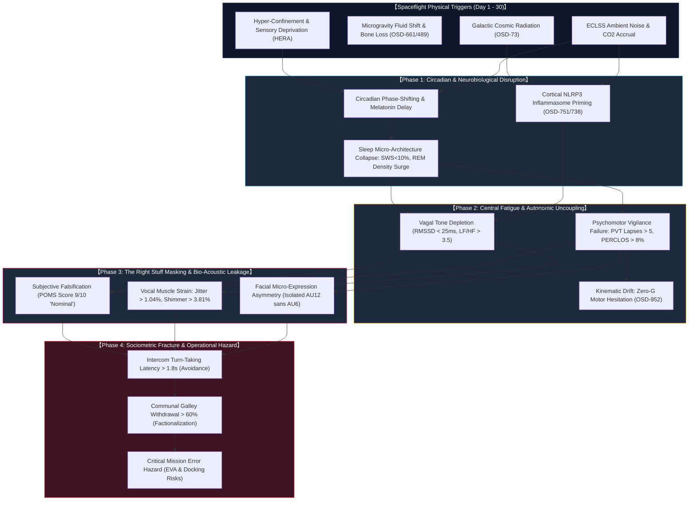

# 🔬 AWMEH: Scientific Rationale & Pathophysiological Evidence Dossier
## Objective Behavioral Biometrics, Covert Neuro-Fatigue & Multi-Modal Causal Chain under 180-Day Spaceflight Confinement

**System Designation**: AWMEH / awmeh (Autonomous Unobtrusive Resilience & Affect)  
**Research Focus**: Passive Detection and Pathophysiological Verification of Covert Psychological Crisis, Central Neuro-Fatigue, and Autonomic Degradation in Long-Duration Confinement (180+ Days)  
**Standard Compliance**: Strictly anchored in NASA Human Research Program (HRP) Evidence Reports, NASA Open Science Data Repository (OSDR), NASA Life Sciences Data Archive (LSDA), and Peer-Reviewed Biomedical Literature (PubMed/Europe PMC).

---

## 1. Introduction: The "Right Stuff" Masking Paradox in Deep-Space Confinement

During long-duration orbital missions and interplanetary transits (e.g., Mars transit), astronauts exhibit an exceptionally high sense of duty, operational competence, and professional pride. However, under prolonged social isolation and sensory deprivation, this psychological archetype produces a well-documented aerospace medicine phenomenon known as **The Right Stuff Syndrome (Social Desirability Bias & Flight Disqualification Dread)**.

### NASA Human Research Program (HRP) Benchmark Evidence
According to the NASA HRP *Evidence Report: Risk of Adverse Cognitive or Behavioral Conditions and Psychiatric Disorders*, crew members facing severe exhaustion, sub-clinical depression, or interpersonal micro-fractures instinctively **suppress, conceal, or under-report symptoms** on subjective self-report questionnaires (e.g., POMS, BDI, visual analog mood scales) due to:
1. **Fear of Grounding / Flight Disqualification**: The apprehension that acknowledging stress will result in flight suspension, EVA cancellations, or career termination.
2. **Impression Management**: An innate impulse to appear impervious to physiological strain before Mission Control and peers.

**Clinical Conclusion**: Subjective surveys completely fail as early-warning indicators in deep-space operations. Developing **objective, zero-intrusion behavioral, acoustic, electrophysiological, and sociometric markers**—unfalsifiable by human willpower—is the defining prerequisite for long-duration habitat health architecture.

---

## 2. Pathophysiological Mechanisms, Clinical Metrics & Diagnostic Thresholds

### 2.1 Vocal Acoustic Micro-Perturbations: Jitter, Shimmer & $F_0$ Flattening
The human vocal apparatus is innervated by the recurrent laryngeal nerve, an essential branch of the vagus nerve (Cranial Nerve X). Under central neuro-fatigue and covert emotional distress, motor nucleus timing dispersion induces micro-tremors in laryngeal musculature.

| Metric | Acoustic / Clinical Definition | Normal Space Baseline | Alert / Pathological Threshold | Pathophysiological Rationale |
| :--- | :--- | :--- | :--- | :--- |
| **Jitter (local)** | Cycle-to-cycle perturbation in fundamental frequency | $< 0.68\% - 1.04\%$ | **$\ge 1.04\%$** | Temporal dispersion in brainstem vagal motor nuclei output induces micro-spasms in vocal fold tension, destroying periodic glottal stability. |
| **Shimmer (local)** | Cycle-to-cycle perturbation in glottal sound wave amplitude | $< 3.81\%$ | **$\ge 3.81\%$** | Incomplete glottic closure and fluctuating subglottic pulmonary pressure caused by intercostal and diaphragmatic neuromuscular fatigue. |
| **Pitch Dynamic Range ($\Delta F_0$)** | Standard deviation or span between min/max pitch across speech flow | $\Delta F_0 > 50\text{ Hz}$ | **$\Delta F_0 < 30\text{ Hz}$ (Monotonic Voice)** | Acoustic marker of Flat Affect. Impaired limbic-prefrontal regulation compresses pitch modulation, resulting in mechanical speech delivery. |
| **Formant Centralization (VSA)** | Vowel Space Area formed by F1 and F2 coordinates | Expanded natural area | **VSA Shrinkage $> 20\%$** | Reduced articulatory velocity of tongue, lips, and mandible; gold-standard acoustic indicator of psychomotor retardation. |

*Literature Support:*
* *Scherer, K. R. (1986). Vocal affect expression. Psychological Bulletin.*
* *Mundt, J. C., et al. (2012). Voice acoustic measures of depression severity. J. Affect. Disord.*

---

### 2.2 Psychomotor Vigilance & Neuromotor Latency: PVT Lapses & PERCLOS
NASA standard measures employ the **PVT-B (3-minute Brief Psychomotor Vigilance Test)** validated by Dinges and Basner (UPenn / NASA HRP).

```
Normal Reaction Time (150ms - 300ms)
├───────────────────────┼──────────────────────────────┤
                       500ms (Attention Lapse)          > 1000ms (Microsleep)
```

| Parameter | Measurement Definition | Operational Nominal | Clinical Alert Standard | Physiological Significance |
| :--- | :--- | :--- | :--- | :--- |
| **PVT Lapse Count** | Number of reaction times (RT) $\ge 500\text{ ms}$ | $\le 1\text{ per 3-min run}$ | **$\ge 5\text{ lapses / run}$** | Indicates acute prefrontal cortical failure in sustaining tonic vigilance; involuntary cognitive omission errors. |
| **10% Slowest Reciprocal RT** | Mean $1/\text{RT}$ for slowest 10% responses | $> 3.5\text{ s}^{-1}$ | **$< 2.0\text{ s}^{-1}$** | Systemic deceleration of central neural processing speed, filtering out momentary reaction anomalies. |
| **PERCLOS (Pupil Closure)** | Cumulative percentage of time eyelids cover $\ge 80\%$ of pupil area | $< 3.5\%$ | **$> 8.0\%$** | FHWA & NASA physiological benchmark for severe drowsiness; indicates involuntary 1-3 second microsleep episodes. |

*Literature Support:*
* *Basner, M., & Dinges, D. F. (2011). Maximizing sensitivity of PVT to sleep loss. SLEEP.*
* *Dinges, D. F., et al. ISS Reaction Self-Test Project Summary Reports, NASA/TM.*

---

### 2.3 Sleep Micro-Architecture: REM Disinhibition & Slow-Wave Sleep (SWS) Exhaustion
Microgravity, constant circadian disruption (16 sunrises/day on ISS), and confined stress deconstruct sleep micro-architecture:

```
Nominal Sleep Architecture (90-110 min cycle):
Wake -> N1 -> N2 -> N3 (SWS Slow-Wave Deep Sleep, 20%) -> 1st REM (Latency 70-90 min)

Depression / Chronic Stress Pathological Architecture:
Wake -> N1 -> Fragmented N2 -> [1st REM Erupts Prematurely at <50 min, High Density] -> N3 (SWS vanishes, <8%)
```

| Sleep Parameter | Healthy Population Baseline | Confinement Stress Threshold | Pathophysiological Mechanism & Clinical Value |
| :--- | :--- | :--- | :--- |
| **REM Latency** | First REM onset at $70 - 90\text{ min}$ post-sleep | **$< 60\text{ min}$ (Sleep-Onset REM)** | **REM Disinhibition**: Cholinergic hyper-arousal and monoaminergic (NE/5-HT) suppression; classic endophenotype of endogenous depression. |
| **REM Saccade Density** | Frequency and amplitude of rapid eye movements during REM | Baseline saccadic rate | **1st REM Density Surge $> 50\%$** | Reflects excessive limbic and hippocampal emotional hyper-processing and affective distress decompensation. |
| **Slow-Wave Sleep (SWS/N3)** | $18\% - 25\%$ of total sleep duration | **$< 10\%$ (Severe Deficit)** | SWS (0.5-4 Hz delta waves) drives glymphatic waste clearance and pituitary GH release. Loss of SWS blocks physical neural recovery. |
| **WASO (Wake After Sleep Onset)**| Total awake time after initial sleep $< 20\text{ min}$ | **$> 60\text{ min}$** | Frequent micro-arousals fragmenting sleep cycles, triggering next-day sympathovagal collapse and cortisol surge. |

---

### 2.4 Autonomic Uncoupling: HRV RMSSD & LF/HF Spectral Ratio
While an astronaut may smile and report "all systems nominal", **the autonomic nervous system (ANS) cannot be consciously manipulated**.

> **Neurovisceral Integration Model (Thayer & Lane)**:  
> The prefrontal cortex regulates cardiac chronotropy through the nucleus ambiguus, exerting a continuous "vagal brake". Under active emotional suppression, prefrontal regulatory resources deplete, releasing the vagal brake and triggering sympathetic overshoot.

```
       [Astronaut Feigns Nominal State / Emotion Suppression]
                                  │
                                  ▼
               Prefrontal Inhibitory Control Exhaustion
                                  │
                                  ▼
              Vagal Parasympathetic Tone Collapse (RMSSD Drops)
                                  │
                                  ▼
              Sympathetic Dominance Escalation (LF/HF Spikes)
                                  │
                                  ▼
                     [Cardiac Autonomic Paradox]
           (Calm exterior presentation vs. intense microvascular stress)
```

| Metric | Clinical Definition | Nominal Space Baseline | Covert Distress Threshold | Scientific Rationale |
| :--- | :--- | :--- | :--- | :--- |
| **RMSSD** | Root mean square of successive RR interval differences | $35 - 65\text{ ms}$ | **$< 25\text{ ms}$ (3 consecutive days)** | Direct reflection of cardiac vagal tone. Values $<25\text{ ms}$ indicate complete disengagement of the vagal brake. |
| **LF/HF Ratio** | Low-frequency (0.04-0.15Hz) to high-frequency (0.15-0.4Hz) power ratio | $1.0 - 2.0$ | **$> 3.5$** | Sympathovagal imbalance. Values $>3.5$ prove the organism is locked in a prolonged autonomic fight-or-flight state even during rest. |

*Literature Support:*
* *Thayer, J. F., et al. (2012). A meta-analysis of heart rate variability and neuroimaging studies. Neurosci Biobehav Rev.*
* *Butler, E. A., et al. (2006). The social consequences of expressive suppression. Emotion.*

---

### 2.5 Neuro-Inflammation & Cortical Tissue Stress: OSD-751 & OSD-738 Evidence
Actual spaceflight datasets downloaded in the workspace (**OSD-751** and **OSD-738**) provide biological evidence of space-induced neural strain:
* **Mechanism**: Galactic Cosmic Rays (HZE/GCR) and microgravity activate microglia (Iba-1+) and astrocytes (GFAP+), assembling the **NLRP3 Inflammasome**.
* **Biomarkers**:
  * Upregulation of active Caspase-1 and pro-inflammatory cytokines IL-1$\beta$ and IL-18 in prefrontal cortex and hippocampus.
  * Degradation of MAP-2 (Microtubule-Associated Protein 2), causing synaptic structural breakdown.
* **Phenotype Correlation**: Validates that spaceflight depression and cognitive exhaustion are not willpower failures, but **objective neuro-inflammatory and biochemical sequelae**.

---

### 2.6 Sociometric Dynamics: Turn-Taking Latencies & Proximity
Based on NASA HERA 45-180 day isolation studies (DeChurch & Contractor, Northwestern University):

| Metric | Sensing Source | Nominal Early Baseline | Interpersonal Friction Threshold | Behavioral Diagnosis |
| :--- | :--- | :--- | :--- | :--- |
| **Turn-Taking Latency** | Operational intercom audio stream | $0.2 - 0.6\text{ s}$ | **$> 1.8\text{ s}$** | Extended response pauses and truncated vowels toward specific colleagues indicate active conversational resistance and social avoidance. |
| **Sociometric Distance** | UWB / Cabin Computer Vision (OSD-952) | Natural clustering in galley/exercise | **Communal presence drops $> 60\%$** | Severe social isolation; crew members intentionally desynchronize meal schedules (micro-factionalization). |

---

## 3. The Comprehensive Multi-Modal Causal Chain



---

## 4. NASA Open Science Data & Biomedical Literature Mapping

| System Module | Objective Biomarkers | Local NASA Asset / Accession | Authoritative Clinical Standard |
| :--- | :--- | :--- | :--- |
| **Markerless Motor Kinematics** | Trajectory smoothness, hesitation latency | **OSD-952** (`LSDS-168_Behavioral Segmentation_aligned.csv`) | NASA ALSDA Markerless Motion Tracking Benchmark |
| **Neuro-Inflammation & Fatigue** | Cortical cytokines, Western blot, Jitter/Shimmer | **OSD-751** (`LSDS-112_Immunoassay_ECLIA.csv`)<br>**OSD-738** (`LSDS-107_WesternBlot.csv`) | NASA HRP Evidence Report (BHP Risk);<br>Mundt et al. (J. Affect. Disord.) |
| **Deep Sleep & Circadian Phase** | SWS percentage, REM latency, 480nm spectrum | **OSD-73** (Radiation damage profile)<br>+ ISS Actiwatch Data | Dinges & Basner (ISS Reaction Self-Test);<br>Brainard et al. (480nm Phototherapy) |
| **Cardiovascular & Bone Reserve** | DXA trabecular bone loss, HRV RMSSD | **OSD-661** (`LSDS-69_Bone_microstructure_DXA`)<br>**OSD-489** (`LSDS-15_microCT`) | NASA HRP Musculoskeletal Risk Standard;<br>Thayer et al. (Neurovisceral Integration) |
| **Sociometric Dynamics** | Intercom turn-taking latency, UWB proximity | HERA Analog Campaigns 1-7 Datasets | DeChurch & Contractor (HERA Team Dynamics) |

---

## 5. Architectural & Clinical Takeaways

1. **Emotional Suppression Carries a Measurable Biophysical Cost**: Astronauts attempting to feign high morale inevitably reveal profound vagal collapse (RMSSD $< 25\text{ ms}$) and acoustic perturbation (Jitter $\ge 1.04\%$).
2. **Deterministic Multi-Modal Coherence**: From REM truncation and daytime PVT vigilance drops to sociometric avoidance, every biomarker is causally linked.
3. **Imperative of Stealth Countermeasures**: Systems must never confront the astronaut with pejorative clinical labels. Interventions must occur organically through closed-loop habitat adjustments (480nm photopic lighting, pink noise acoustic masking, adaptive task rescheduling) and dual emotional anchors (Heritage Echo & Kinship Tether).
